# ClariVid AI — Mini Project Documentation

**Project Title:** ClariVid: An Interactive, Fact-Audited AI Explainer Generator  
**Subject:** AI Tools and Prompt Engineering  
**Project Type:** Mini Project  
**Date:** November 2026  
**Presented By:** Ayush Patil *(Roll No. / Div)*  
**Guided By:** Prof. *[Mam's Name]*  

---

## 1. Abstract

**ClariVid AI** is a full-stack educational micro-learning studio that converts any study topic into an interactive, scene-by-scene storyboard with synchronized browser text-to-speech (TTS) narration, automated dual-LLM factual auditing, adaptive checkpoint quizzes, and side-by-side prompt engineering benchmarking.

Unlike conventional AI video generators that output static, linear MP4 files with generic accuracy disclaimers, ClariVid treats each lesson as **structured JSON data**. This architectural choice enables real-time fact verification by an independent Critic agent, confusion-triggered scene re-explanation when a student answers a quiz incorrectly, natural code-mixed **Hinglish** explanations, and **Exam-Blueprint tags** tailored for Indian university and board exams.

---

## 2. Problem Statement & Gap Analysis

Existing AI explainer platforms (such as Invideo, Magiclight, X-Pilot, and Google NotebookLM) are optimized for **content production** rather than **active student learning**. Five recurring gaps motivate this project:

| # | Gap in Existing Tools | Impact on Learners | ClariVid's Solution |
|---|---|---|---|
| 1 | **Passive Linear Playback** | Students cannot pause to adapt or simplify an explanation mid-lesson. | **Interactive Scene Player:** Structured JSON slides with play/pause, navigation, and quiz checkpoints. |
| 2 | **Unverified Hallucinations** | Only generic disclaimers are shown; wrong formulas look as confident as right ones. | **Dual-LLM Fact-Audit:** A Critic agent scores every scene (`0–100`), flags flaws, and suggests `corrected_text`. |
| 3 | **One-Size-Fits-All Pace** | Personalization stops at the initial prompt; lessons never adapt to confusion. | **Adaptive Re-Explainer:** Wrong quiz answers trigger an empathetic tutor rewrite of the next scene. |
| 4 | **Weak Indian Context Fit** | Standard English or literal dubbing lacks Hinglish fluency and exam focus. | **Hinglish + Exam Tags:** `hi-IN`/`en-IN` TTS narration and tags (`2-Mark`, `5-Mark`, `Numerical`, `Conceptual`). |
| 5 | **Black-Box Prompting** | Users and developers cannot see how prompt design changes output quality. | **Prompt Inspector (A vs B):** Benchmarks Zero-Shot against Role + Few-Shot + Schema prompting live. |

---

## 3. Objectives

1. **Build an interactive explainer web application** that generates 5–7 scene micro-lessons from any topic, difficulty level, and language.
2. **Mitigate AI hallucinations** using a second-agent Critic LLM that audits factual soundness and exposes confidence badges in the UI.
3. **Support Indian student workflows** with natural code-mixed Hinglish narration and exam-mark relevance tags.
4. **Adapt lessons dynamically** using embedded checkpoint quizzes and confusion-triggered scene re-explanation.
5. **Demonstrate prompt engineering empirically** through a built-in Prompt Inspector comparing Zero-Shot (Prompt A) vs. Role + Few-Shot + Schema-Constrained (Prompt B).

---

## 4. System Architecture

ClariVid follows a **three-tier, dual-LLM pipeline** built with **React 19 + Vite 8** on the frontend, **Node.js + Express 4** on the backend, and **Google Gemini (`@google/genai`)** on the AI layer.

```mermaid
flowchart LR
    U["User Input<br/>(Topic, Level, Language, Prompt A/B)"] --> FE["React Frontend<br/>(LessonForm & ScenePlayer)"]
    FE -->|"POST /api/generate"| BE["Express Backend<br/>(Rate Limit + Memory Cache)"]
    BE --> VAL["Validator & Retry<br/>(callWithRetry)"]
    VAL -->|"Gemini 2.5 Flash<br/>(Fallback: 1.5 Flash)"| LLM1["LLM 1: Storyboard Generator"]
    LLM1 -->|"Validated JSON<br/>(5-7 Scenes)"| CRITIC["LLM 2: Critic Agent<br/>(POST /api/audit)"]
    CRITIC -->|"Confidence 0-100<br/>+ Issues + Fixes"| PLAYER["Scene Player + Web Speech TTS"]
    PLAYER --> QUIZ["Checkpoint Quiz"]
    QUIZ -->|"Correct"| NEXT["Next Scene"]
    QUIZ -->|"Wrong Answer"| REEX["Adaptive Re-Explainer<br/>(POST /api/reexplain)"]
    REEX --> NEXT
```



### 4.1 Backend REST API Endpoints (`server/index.js`)

| Endpoint | Method | Purpose |
|---|---|---|
| `/api/health` | `GET` | Returns server status, `mockAi` flag, and timestamp. |
| `/api/generate` | `POST` | Generates a 5–7 scene storyboard using Prompt A or Prompt B with schema validation and 1 auto-retry. |
| `/api/audit` | `POST` | Runs the Critic LLM to evaluate factual accuracy and return confidence scores, issues, and `corrected_text`. |
| `/api/compare` | `POST` | Runs Prompt A and Prompt B side-by-side and returns latency, schema compliance, scene count, and audit metrics. |
| `/api/reexplain` | `POST` | Rewrites the upcoming scene with simpler analogies when a student answers a checkpoint quiz incorrectly. |
| `/api/ask` | `POST` | Handles contextual student questions during a lesson. |
| `/studio` | `GET` | Serves the dark-themed **ClariVid Canvas & Video Studio** (`clarivid_ai_educational_video_creator_studio.html`). |

### 4.2 Resilience & Reliability Layer

- **Exponential Backoff & Model Fallback (`server/services/geminiClient.js`):** Retries transient errors and routes to `GEMINI_FALLBACK_MODEL` (`gemini-1.5-flash`) if the primary `GEMINI_MODEL` (`gemini-2.5-flash`) is unavailable.
- **429 Quota Fast-Fail:** Immediately detects daily quota exhaustion (`quota_exceeded`) without wasting redundant backoff retries.
- **In-Memory Cache (`server/services/cache.js`):** Serves repeated topic queries instantaneously.
- **Offline `MOCK_AI` Mode:** Runs against realistic pre-computed fixtures when `MOCK_AI=true`, ensuring zero-dependency classroom demonstrations.

---

## 5. Prompt Engineering Techniques

Every prompt engineering technique in ClariVid is modularized inside `server/prompts/` and `server/services/`:

| # | Technique | Prompt / File | Key Implementation Details |
|---|---|---|---|
| 1 | **Zero-Shot Prompting** | `server/prompts/promptA.js`<br>(`buildPromptA`) | Baseline prompt requesting a JSON storyboard without a persona, few-shot example, or strict length constraints. |
| 2 | **Role + Few-Shot + Schema-Constrained** | `server/prompts/promptB.js`<br>(`buildPromptB`) | Assigns an `"experienced B.Tech professor"` persona, provides 1 complete example scene, and enforces strict schema rules: **5–7 scenes**, **≤120 words** narration, **4 checkpoint options**, and **1 of 4 exam tags**. |
| 3 | **Critic / Self-Verification** | `server/prompts/criticPrompt.js`<br>(`buildCriticPrompt`) | Assigns a `"rigorous, multi-disciplinary academic fact-checker"` persona to audit each scene, returning a `0–100` confidence score (`<70` if flawed), itemized issues, and `corrected_text`. |
| 4 | **Adaptive Re-Prompting** | `server/prompts/reexplainPrompt.js`<br>(`buildReexplainPrompt`) | Uses an `"expert, empathetic tutor"` persona to rewrite the next scene using simpler analogies after a wrong quiz answer. |
| 5 | **Retry with Validation** | `server/services/validator.js`<br>(`callWithRetry`) | Catches JSON parsing or schema validation failures and performs **1 automatic retry** by appending static reinforcement instructions. |

### Prompt A vs. Prompt B Benchmarking (`PromptInspector.jsx`)

The **Prompt Inspector** tab runs `/api/compare` to benchmark both techniques on identical inputs across four metrics:
- **Generation Latency (ms)**
- **JSON Schema Compliance (%)**
- **Scene Count**
- **Critic Audit Confidence (0–100)**

---

## 6. Key Prototype Features

1. **Interactive Scene Player (`ScenePlayer.jsx`):** Renders bite-sized scenes with visual hints, concept breakdowns, progress bar, and keyboard/button controls.
2. **Synchronized Browser Narration:** Uses the native **Web Speech API** (`speechSynthesis`) with `hi-IN` and `en-IN` voices for zero-cost English and Hinglish audio playback.
3. **Visual Confidence Badges:**
   - **High Confidence (`80–100`):** Green badge — factually verified.
   - **Moderate Confidence (`70–79`):** Yellow badge — minor ambiguity with expandable issue details.
   - **Low Confidence / Flawed (`0–69`):** Red warning badge — highlights factual errors and offers one-click corrected text.
4. **Exam-Blueprint Tags:** Every scene is categorized as `2-Mark Definition`, `5-Mark Diagram`, `Numerical`, or `Conceptual`.
5. **UI Modes:** Features a high-contrast Neo-Brutalist default interface, a distraction-free **Calm Mode** (`?calm=1`), and a dark **ClariVid Canvas Studio** (`/studio.html`).

---

## 7. Technology Stack & Project Structure

- **Frontend (`client/`):** React `19.3.1`, Vite `8.3.6`, Axios `1.21.1`, Web Speech API, CSS Variables.
- **Backend (`server/`):** Node.js (v18+), Express `4.21.2`, `@google/genai` `1.0.0`, `express-rate-limit` `7.5.0`, `cors`, `dotenv`.
- **AI Models:** `gemini-2.5-flash` (Primary), `gemini-1.5-flash` (Fallback).

```text
Clarivid AI/
├── client/
│   ├── src/
│   │   ├── App.jsx                 # Main shell, tab switcher, Calm Mode
│   │   ├── App.css                 # Neo-Brutalist + Calm Mode styles
│   │   ├── components/
│   │   │   ├── LessonForm/         # Topic, difficulty, language, prompt A/B
│   │   │   ├── ScenePlayer/        # Slides, TTS, confidence badge, quiz
│   │   │   └── PromptInspector/    # Side-by-side Prompt A vs B benchmark
│   │   └── hooks/useLesson.js      # State & API orchestration
│   └── studio.html                 # Dark-mode ClariVid Studio
├── server/
│   ├── index.js                    # Express entry point (port 3001)
│   ├── prompts/                    # promptA, promptB, criticPrompt, reexplainPrompt
│   ├── routes/                     # generate, audit, compare, reexplain, ask
│   ├── services/                   # geminiClient, validator, cache
│   ├── scripts/evaluate.js         # Topic evaluation benchmark runner
│   └── test/run.js                 # Zero-dependency automated test suite
└── ClariVid_Mini_Project_Presentation.pptx
```

---

## 8. Testing, Evaluation & Demo Modes

### 8.1 Automated Test Suite (`server/test/run.js`)
Run `cd server && npm test` to execute **5 automated assertions** using injected mock AI responses (zero API quota used):
1. Valid storyboards pass schema validation with a **100** compliance score.
2. Malformed JSON triggers **exactly 1** auto-correction validation retry.
3. HTTP `429` daily quota exhaustion aborts immediately (`quota_exceeded`) without redundant retries.
4. `/api/compare` returns results for both prompts even if one side encounters an error.
5. Scene re-explanation produces a valid, simplified replacement scene.

### 8.2 Evaluation Benchmark Runner (`server/scripts/evaluate.js`)
Run `cd server && npm run evaluate -- --confirm` (with a valid `GEMINI_API_KEY`) to benchmark Prompt A vs. Prompt B and Critic accuracy across **TCP Three-Way Handshake**, **Photosynthesis**, and **Newton's Laws of Motion**.

### 8.3 Built-In Live Demo URLs
- `http://localhost:5173/?demo=flawed` — Loads a TCP Handshake lesson with a planted 4-step error and precomputed Critic audit (`<70` confidence).
- `http://localhost:5173/?demo=flawed-bio` — Loads a Photosynthesis lesson with a planted biology flaw.
- `http://localhost:5173/?audit=live` — Forces a live Gemini API Critic audit, bypassing precomputed fallbacks.

---

## 9. Conclusion & Future Scope

ClariVid demonstrates that combining **structured prompt engineering** (Role + Few-Shot + Schema Constraints) with a **dual-LLM Critic verification loop** transforms generative AI from a passive, error-prone content tool into a **trustworthy, adaptive learning companion**.

### Future Roadmap
- **Phase 1 — Midnight Neo-Brutalist Dark Mode:** Header toggle (`Normal | Dark`) with `localStorage` persistence for comfortable night study.
- **Phase 2 — Full Pause-and-Ask Micro-Scenes:** Seamless inline insertion of live Q&A scenes into the active storyboard timeline.
- **Phase 3 — PDF / MP4 Export:** One-click downloadable exam revision notes and rendered video summaries.
- **Phase 4 — Learner Analytics:** Persistent quiz performance tracking and weak-topic revision history.
